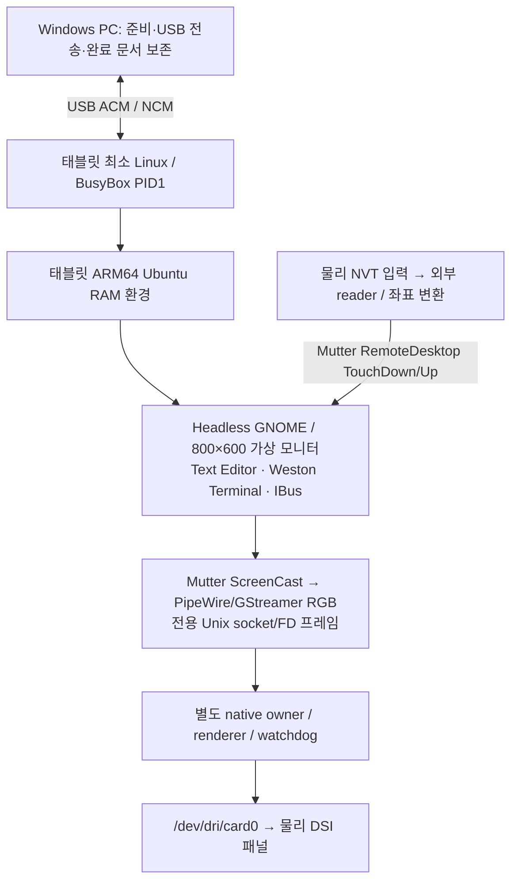

# Lenovo TB375FC 네이티브 Linux 개발일지 및 화면 재표시 장애 기술 문의

작성 기준: **2026-11-24, 한국 시각(KST, UTC+9)**  
기록 범위: 초기 부트로더·부팅 이미지 개조부터 2026-11-24 두 번째 사진 표시 시험까지  
목적: 외부 개발자에게 현재 구현 상태와 재현 자료를 설명하고, 화면의 세로 명암선 깨짐 원인에 대한 검토를 요청하기 위한 자료

> **현재 결론: 화면 재표시 시 발생하는 세로 명암선 깨짐의 근본 원인은 아직 찾지 못했다.**
> Linux 부팅, RAM Ubuntu 실행, 제한된 GUI 작업과 파일 보존은 확인했다. 그러나 같은 Linux 부팅에서 화면을 다시 활성화하면 문제가 재현된다. 최근의 grid 복원 호출 한 곳 생략 후보도 2026-11-24 시험에서 재발을 막지 못했다.
>
> 이 문서에서 “수집 성공”, “정리 성공”, “화면 안정 성공”은 서로 다른 결과다. 프로그램이 정상 종료하고 기록을 정확히 회수했어도 실제 패널에는 깨짐이 나타날 수 있다.

## 1. 먼저 검토를 부탁드리는 내용

현재 가장 도움이 필요한 부분은 **Android BSP 커널의 MediaTek DRM/패널 전원 전환과 Novatek 터치 드라이버의 firmware·IRQ·설정 복원 경로가 함께 움직일 때 발생하는 문제**다.

관찰된 현상은 다음과 같다.

1. 새 Linux 부팅의 첫 화면 활성화에서는 정상 사진과 유효 터치 좌표를 얻은 이력이 있다.
2. 같은 부팅에서 화면을 껐다 다시 켜면, 처음에는 정상 사진이 보이다가 세로 방향의 밝고 어두운 띠·명암 깨짐이 발생할 수 있다.
3. 터치를 하지 않은 시험에서도 재현됐다. 손가락 조작이 반드시 필요한 조건은 아니다.
4. 재표시 시 Novatek point-packet checksum 불일치, firmware reset 회복, firmware update 성공 메시지, 일부 extended command 실패가 반복된다.
5. 최신 추적에서는 저수준 SPI 전송의 반환값과 요청/실제 길이가 정상이어도 위 오류와 광학 깨짐이 함께 존재했다.
6. 화면을 정상적으로 비활성 상태로 복구할 수 있으며 USB 제어 셸도 유지된다. 화면이 꺼졌다는 사실을 태블릿 전체 전원 종료나 커널 중단으로 해석하지 않는다.

특히 다음 질문에 대한 의견을 구한다.

- 첫 활성화의 already-resumed/기존 하드웨어 상태와, 두 번째 활성화의 firmware·restore 경로 차이에서 무엇을 우선 비교해야 하는가?
- point IRQ 처리, firmware 복구, 설정 명령이 개별 SPI mutex 외에 어떤 상위 단위로 직렬화돼야 하는가?
- Touch/Display 통합 또는 공유 reset·전원 경로 때문에 터치 쪽 firmware 회복이 패널 상태를 바꿀 가능성을 어떻게 검증하는 것이 적절한가?
- resume 초기에 IRQ를 허용하는 시점, firmware 준비 완료, pen/game/grid 명령의 중복·ACK 순서를 어떻게 구분해야 하는가?
- 30Hz DRM 모드가 패널에서 광고되고 첫 표시가 성공하는 상황에서, warm 전환에 필요한 vendor 전용 상태 복원이나 MIPI/DSC/PPS·전원 순서가 누락됐는지 확인할 지점은 무엇인가?
- 아래 로그만으로 추가로 확인할 수 있는 사실과, 별도의 계측이 필요한 사실을 구분해 주시면 도움이 된다.

**원인을 특정해 두고 확인을 요청하는 문서가 아니다.** 현재 자료로는 SPI/firmware 오류가 광학 깨짐의 원인인지, 공통된 잘못된 재개 상태의 결과인지, 다른 경로와 동반되는 현상인지 확정하지 못했다.

## 2. 장치와 현재 실행 환경

| 구분 | 확인한 내용 | 주의할 점 |
|---|---|---|
| 장치 | Lenovo TB375FC PRC / P98300DA2 | 단일 실기기에서 진행한 기록이다. |
| SoC 식별 | MT6897 / MT8792 계열 식별값 | 초기 실기기 inventory 및 프로젝트 문서 기준이다. |
| 메모리·저장소 | RAM 8GB, 저장소 128GB급 | 원본 GPT의 전체 크기는 127,959,826,432바이트다. |
| 원래 OS | Android 14, ZUI 16.0.20.041 (241111) | 다른 버전 복구 패키지와 실제 .041 원본 백업을 구분했다. |
| 실제 사용하는 커널 | `6.1.25-android14-11-g4528d59d4335-ab11203497`, AArch64 | 현재 실행 결과를 mainline Linux 이식 성공으로 설명하지 않는다. |
| 최소 Linux PID1 | `/bin/busybox` 기반 init | Ubuntu systemd가 PID1인 완전한 부팅은 아니다. |
| Ubuntu | Ubuntu 24.04.5 ARM64 사용자 공간을 RAM에 배치 | PC에서 다시 올리는 chroot/분리 환경이다. 내부 저장소 영구 설치가 아니다. |
| 디스플레이 | MediaTek DRM, DSI-1, 2944×1840 | 최신 사진 시험은 아래의 고정 30Hz 타이밍을 사용했다. |
| 입력 | NVT capacitive touch / pen 장치 | 장치 노드 등록과 유효 좌표 수신을 구분했다. |
| 제어·전송 | USB ACM 제어 셸 + NCM 파일 전송 | COM 번호·NIC 번호는 부팅/재연결마다 확인한다. |
| PC 준비 환경 | Windows, PowerShell, Python, WSL, ARM64 교차 빌드 및 격리된 가상 환경 | PC/QEMU 성공은 실기기 성공으로 계산하지 않았다. |

최신 사진 표시 도구가 허용한 모드는 패널이 반환한 다음 타이밍과 정확히 일치해야 한다.

```text
2944 x 1840 @ 30 Hz
clock_khz = 770472
hdisplay = 2944, hsync_start = 3034, hsync_end = 3044, htotal = 3132
vdisplay = 1840, vsync_start = 8016, vsync_end = 8018, vtotal = 8200
hskew = 0, vscan = 0, flags = 0
```

모드 목록에는 144/120/60/30Hz가 관찰됐지만, 이 기록이 모든 모드의 안정 동작을 증명하지는 않는다. 반대로 30Hz라는 이유만으로 미지원 모드가 원인이라고 확정할 근거도 없다.

## 3. 무엇을 실제로 개조했고, 무엇은 RAM 작업인가

### 3.1 실제 영구 변경이 있었던 초기 작업

초기 기록 기준으로 다음은 실제 태블릿 부팅 영역/상태에 적용된 작업이다.

- 선정한 24개 원본 파티션, 총 617,611,264바이트(589MiB)를 백업하고 GPT/CRC/조각·전체 해시를 확인했다. **전체 128GB 백업은 아니다.**
- DEV LK_B 16MiB를 실제 기록하고 전체 읽기 검증을 거쳤다. 사용자 조작으로 critical unlock 및 userdata 초기화가 관찰됐다.
- 이후 원본 .041 LK_B를 복원하고 읽기 검증했다. 최종적으로 DEV LK를 계속 사용한 상태라고 설명하지 않는다.
- `init_boot_b`에 최소 RAM Linux용 부팅 이미지를 기록해 실제 Linux USB 셸 부팅을 확인했다.
- 뒤에 B/A/C 드라이버 후보 및 최신 grid 호출 생략 후보를 `init_boot_b`에 각각 적용한 이력이 있다.

따라서 문서 중 “이번 회차 UFS 쓰기 0”은 해당 진단 회차에 대한 설명이다. 프로젝트 전체에서 파티션을 한 번도 쓰지 않았다는 뜻이 아니다.

### 3.2 주로 RAM에서 진행한 후속 개발

Ubuntu rootfs, 진단 실행 파일, 임시 화면 데이터, 문서 편집 파일과 시험 로그는 RAM 작업 경로에 배치했다. 재부팅하면 Ubuntu와 해당 RAM 작업물은 사라지고 PC가 다시 준비한다. 완료한 사용자 문서는 PC에 별도로 회수한다.

Android 프레임워크를 거치지 않는 최소 Linux 부팅은 확인했지만, Android 저장 영역을 모두 없애고 일반적인 독립 Ubuntu 기기로 전환한 것은 아니다. 부트로더 잠금 해제 과정의 초기화와, 이후의 영구 Ubuntu 설치 여부도 구분해야 한다.

터치 firmware는 원래 드라이버의 다운로드 경로로 실제 컨트롤러에 적용한 이력이 있다. 이것은 단순한 PC 파일 복사와 다르다. 과거 감사에서는 모든 SPI 쓰기의 영구성을 완전히 확정하지 못했으므로, “모든 하드웨어 쓰기가 RAM에만 있었다”는 포괄적인 표현은 사용하지 않는다.

## 4. 구현된 GUI의 실제 구조

현재 확인한 GUI 경로는 **태블릿 ARM64 Ubuntu RAM의 headless GNOME → 캡처/전송 → 별도 native DRM 표시 브리지**다.



구체적으로 확인한 사항은 다음과 같다.

- 태블릿 native workload가 별도 mount/net namespace와 chroot를 구성하고 권한을 내린 뒤 ARM64 Python guest를 실행한다.
- GNOME Shell은 `--headless --wayland --no-x11 --sm-disable --virtual-monitor=800x600` 계열로 실행한다.
- guest는 `/dev/dri` 직접 접근을 금지하며 소프트웨어 렌더링을 요청한다. 따라서 GNOME가 물리 DRM을 직접 점유하거나 GPU 가속이 완성됐다고 설명하면 틀린다.
- 실제 앱은 **GNOME Text Editor와 Weston Terminal**이다. 후자를 GNOME Terminal로 부르지 않는다.
- 화면은 Mutter RemoteDesktop/ScreenCast와 PipeWire/GStreamer를 거쳐 RGB 프레임으로 나오고, 외부 native owner가 XR24 캔버스와 물리 DRM을 관리한다.
- 터치 역시 guest의 직접 evdev 접근이 아니라 외부 입력 reader와 좌표 변환을 거쳐 Mutter에 전달된다.
- 초기 RAM Notes는 별도 GTK4 시험 앱이었다. PC용 RAM Notes fixture 문서와 나중의 실물 stock-app 실행을 혼동하지 않는다.
- 이 경로에서 실제 ARM64 앱이 태블릿에서 실행됐다는 것과, 완전한 Ubuntu 로그인/직접 GPU 데스크톱이 완성됐다는 것은 별개다.

GUI 관련 구조 확인은 현재 보존된 combined-use 코드와 기반 C 파생을 읽은 결과다. 모든 과거 실물 세션의 최종 소스 체인을 이번 문서 작성에서 전부 다시 감사한 것은 아니다.

## 5. 날짜별 개발일지

날짜는 가능한 한 한국 시각을 기준으로 적었다. 로그 파일명은 UTC를 사용하는 경우가 있어 날짜가 하루 다를 수 있다. 예를 들어 B 후보의 `20261031-15:35 UTC` 로그는 한국 시각 11월 1일 새벽 작업이다. 정확한 날짜가 대화에 없는 중간 시험은 범위와 순서만 기록했다.

### 5.1 초기 준비와 첫 개조 — 2026-10-26 인계 시점까지

**목표:** Android 실행 환경 대신 장치에서 직접 Linux를 부팅하고, 복구 가능한 제어 통로를 확보하는 것.

- 실기기 모델·커널·메모리·저장소·파티션 정보를 읽었다.
- 초기 부트로더 잠금 상태, PreLoader 연결, 공식 복구 패키지와 도구를 조사했다.
- 큰 파티션 읽기가 도중에 끊기는 문제가 있어 작은 구간으로 나누고 중복 읽기/해시로 원본을 확인했다. 부분 읽기 파일을 완전한 백업으로 표시하지 않았다.
- 24개 선정 파티션 백업을 완료했다.
- DEV LK 경로와 사용자 선택에 의한 critical unlock, userdata 초기화, 원본 LK_B 복원을 진행했다.
- 최소 initramfs를 만들고 원래 커널에 맞춘 USB 진단 셸을 준비했다.
- **10월 26일 22:56 KST에 실제 RAM Linux 부팅을 확인했다.** PID1 BusyBox, AArch64 커널, USB 제어 셸, RAM/가상 파일시스템을 확인했다.
- 최초 수집 결과가 false였던 이유 중 하나는 종료 마커와 셸 프롬프트가 같은 줄에 붙은 수집기 형식 문제였다. Linux 부팅 실패와 구분해 원본 결과를 보존하고 별도로 해석·수정했다.

주요 근거: [H01], [H02].

### 5.2 첫 물리 화면과 터치 firmware — 2026-10-27

- 원래 `board_temp.ko`를 RAM에 전송하고 적재해 온도 센서를 읽었다.
- 2944×1840/30Hz 색상 무늬를 약 10초 실제 액정에 표시했다. 표시 후 원래 DRM 속성/plane 상태로 복원했다.
- 손가락을 움직인 시험에서 입력 이벤트가 0건이었다. 노드가 등록됐다는 사실을 터치 성공으로 보지 않았다.
- 부팅 로그에서 `novatek_ts_fw_tm.bin` 파일 요청 실패(`-2`)와 FW 정보 이상을 확인했다.
- 실제 .041 원본 `vendor_a`에서 245,760바이트 firmware를 추출하고 RAM의 검색 경로에 배치했다.
- 정상 resume 경로에서 `Update firmware success`, fw_ver `0x09`, fw_type `01`, PID `6080` 메시지를 얻었다.
- **파일 누락 문제를 해소했어도 유효 터치는 여전히 나오지 않았다.** 화면 깨짐→정상→사라짐과 checksum/FD 관련 메시지를 관찰했다.
- 뒤에 출력된 ESD unlock timeout을 최초 원인으로 단정하지 않았다.

firmware SHA256:

```text
ab461f3b5a07e172aebff863c5b4a3a4697b90196e57f1b8d954ddec9691bd58
```

주요 근거: [H03], [H04].

### 5.3 USB 전송과 Ubuntu ARM64 실행 — 2026-10-28 전후

- 기존 ACM 제어 연결을 유지하며 NCM 파일 전송 연결을 추가했다.
- 작은 probe 파일을 먼저 검증한 뒤 Ubuntu ARM64 archive 371,003,142바이트를 전송하고 전체 SHA256을 맞췄다.
- RAM에 rootfs를 풀고 Python 3.12.3, GCC 13.3.0, SSL, SQLite 메모리 DB, JSON 등을 실제 태블릿에서 실행했다.
- 작은 C 프로그램을 태블릿에서 직접 컴파일해 ELF64/AArch64 및 정상 실행을 확인했다.
- Ubuntu 전용 dev tmpfs와 devpts/PTY를 만들고 입출력을 검증했다. PID1은 계속 최소 Linux의 BusyBox였다.
- USB 주소 전용 TCP challenge/응답 시험을 수행하고 임시 서버를 종료했다. 상시 SSH나 일반 네트워크 서비스가 완성된 것은 아니다.
- 배터리 감소와 재연결로 RAM 환경이 사라진 경우 새 부팅에서 다시 구성했다. `Charging` 문자열만으로 실제 충전량 증가를 가정하지 않았다.
- 커널 로그 대량 base64 수신이 잘려 기존 RAM 원본을 작은 조각으로 회수했다. 실제 관찰 자체와 PC 저장 실패를 구분했다.
- 저장장치 sysfs와 원본 GPT를 대조했다. 당시 82개 파티션의 이름/offset/length가 일치했지만, 이 확인만으로 포맷이나 영구 설치를 실행하지 않았다.
- 작은 서비스 관리자 prototype의 정상·누락·crash·ready-timeout·restart-limit 경로를 검증했다. 일반 systemd 부팅이나 완전한 서비스 관리자가 완성된 것은 아니다.

Ubuntu archive SHA256:

```text
4ecce314f253ce69de9684dc0ce44b41f3477314c4af5cb8eb84d15fdf957444
```

주요 근거: [H05], [H06].

### 5.4 첫 화면과 재개 화면을 분리한 시험 — 2026-10-29

- 새 부팅에 Ubuntu, USB, VFS, PTY를 복원했다.
- 첫 화면·터치 동기 시험은 실제 무늬가 안정적으로 보였으나 입력은 0건이었다.
- 이때 `nvt_ts_resume`가 already-resumed 경로로 건너뛰었고 FW 재요청은 없었다. RAM에 파일이 있다는 것과 컨트롤러에 다시 적용됐다는 것을 구분했다.
- 두 번째 정상 resume에서는 FW 성공 후 설정 복원 명령 실패, checksum/FD, FW 재적재가 반복됐다.
- 사용자는 점진적 깨짐→전체 깨짐→검정→정상 회복→꺼짐을 보았다.
- 해당 회차의 새 구간에는 FW 성공 17회, checksum 오류 151건, FD 회복 15회가 기록됐다.
- 최초 명시적 ESD 실패는 첫 입력 오류보다 약 8.135640초 뒤였다. 뒤의 mutex unlock timeout 역시 최초 원인으로 단정하지 않았다.
- 프로그램의 화면 복구·자식 회수·원문 수집은 성공했지만 화면·터치는 해결되지 않았다.

주요 근거: [H07].

### 5.5 펜 명령·grid·동기화 가설 재검토 — 2026-10-30

- 과거 세 로그를 다시 정렬하니 두 로그에서는 checksum 오류가 `0x7B` 명령 실패보다 먼저 발생했다.
- 따라서 “7B 실패가 항상 최초 장애”라는 설명을 유지하지 않았다.
- FD 덤프 여러 줄을 독립 실패 횟수로 잘못 세지 않도록 구분했다.
- 원래 모듈의 역어셈블리에서 point 처리, FW update, 설정 복원, 개별 SPI mutex 범위를 조사했다.
- 개별 SPI 전송에는 별도 mutex가 있지만, 복수 전송으로 이루어진 page 선택/명령/ACK 묶음과 point/FW 작업 사이의 동기화 범위를 별도로 살펴야 한다는 단서를 얻었다.
- 이 결과는 물리적으로 두 SPI 전송이 동시에 일어났다는 증거가 아니며, 잠금 수정이 곧 해결책이라는 의미도 아니었다.

주요 근거: [H08].

### 5.6 전송 길이와 30/60Hz 대조, headless 그래픽 — 2026-10-31

- trace 형식의 배열 이름/크기 해석 오류로 실제 화면 전에 중단된 시도가 있었다. parser 수정본을 별도 버전으로 만들었다.
- V8a 30Hz, V9 30Hz, V9b60 60Hz에서 요청 길이·frame/actual 길이와 caller 수신 데이터를 추적했다.
- caller의 108바이트와 RX 108바이트가 일치하고 64바이트 뒤도 변하는 자료가 나왔다. “앞 64바이트만 갱신된다”는 단순 가설과는 맞지 않았다.
- 이 시기의 원격 시험은 광학 화면 안정 여부를 직접 검증하지 못한 경우가 있으므로, 전송 결과를 화면 정상으로 확대하지 않았다.
- grid 재시도 사이 다른 FW 복구 경로의 page 선택이 끼어드는 witness를 조사했다. 실제 잘못된 주소 수용이나 물리 손상까지 확정한 것은 아니다.
- Ubuntu ARM64 Weston 13.0.0 headless/Pixman에서 Wayland 왕복, surface commit/frame-done을 실제 태블릿에서 확인했다.
- shared memory 제한과 PC 로그 수신 누락을 수정했다. 이 headless 시험은 물리 액정·입력 활성화 성공과 별개다.

주요 근거: [H09], [H10].

### 5.7 B → A → C 후보의 실제 부팅 비교 — 2026-11-01

후보 이름의 알파벳 순서와 실제 시험 순서는 다르다. 보존 문서와 UTC 로그 기준으로 **B → A → C** 순서다.

| 후보 | 변경 범위 | 첫 활성화 | 후속 활성화 | 판단 |
|---|---|---|---|---|
| B | 기존 초기 pen(0) 호출 조건 분기 4바이트 변경, grid 잠금 없음 | 유효 좌표 616회, 사진 안정 | 입력 0, checksum/FW 회복 반복. 5초 사진은 안정적이었다는 관찰도 있음 | warm 터치 해결 아님. 한 회차의 시각적 안정으로 일반 개선을 확정하지 않음 |
| A | grid 관련 잠금 후보 | 유효 좌표 521회, 사진 안정 | 손가락을 움직여도 좌표 없음. 추가 시험에서 세로 띠 확대, 연속사진 30장 | A만으로 warm 문제 해결 안 됨 |
| C | A grid 잠금 + B pen 조건 분기 NOP 조합 | 유효 좌표 522회, 사진 안정 | **손을 대지 않은 상태**에서 세로 띠·깨짐. checksum/FW 회복 반복 | 접촉 없이 재현, C 조합도 미해결 |

중요한 정정과 한계:

- C의 두 번째 시험은 무접촉 조건이므로 입력 0 자체가 터치 실패의 증거는 아니다. 무접촉 화면 깨짐 재현이 핵심이다.
- B의 grid 결과는 “9회 모두 실패”가 아니라 **첫 1회 실패, 후속 8회 성공**으로 정정됐다.
- A는 재링크된 ELF여서 다른 후보의 파일 offset을 그대로 적용하면 안 됐다.
- suspend 경로에서 취소하는 `ts+0x1C0` 작업은 FW가 아니라 charger delayed_work였다. FW의 `ts+0x10`, 전역 restore 작업의 `.bss+0x1C0`와 구분했다.
- Fastboot OKAY, 새 부팅과 초기 모듈/firmware 검사는 파티션 전체 raw readback이나 실행 중 코드 메모리 해시 측정과 다르다.

주요 근거: [H11], [H12], [H13].

### 5.8 제한된 창·키보드·명령 입력 — 11월 초~11월 7일 전후

이 구간의 개별 날짜가 모두 확인되는 것은 아니므로 사용자 대화 순서를 중심으로 적었다.

- 초기 편집기/터미널 형태의 두 창과 화면 키보드를 시험했다.
- 키보드 크기를 확대해 네 줄이 보이고 누르기 쉬워졌다는 확인을 받았다.
- `pwd`, `write hi`, `cat` 등을 입력해 RAM 파일 쓰기/읽기를 확인했다.
- 약 5분 화면 유지 후 같은 내용이 다시 보이는 시험을 진행했다.
- 상단 작은 무지개 아이콘은 위치를 알아보기 어렵고 터치 반응을 판단하기 힘들었다.
- 큰 `Graphics test` 버튼으로 바꾼 후 한 번 눌렀을 때 작은 그래픽 창이 열리고 자동으로 닫히는 동작을 확인했다.
- `?123`의 꺾쇠처럼 보이는 키에서 `^[[C`가 입력되는 문제가 있었다. 이는 패널 세로선 장애가 아니라 키 의미/배치 문제였다.
- 전용 `>` 키를 배치하고 `pwd>n` 입력을 확인했다. 리다이렉션 뒤 출력이 없는 것은 정상일 수 있다.

여기서 사용한 초기 제한형 터미널/편집기와 뒤의 실제 stock 앱을 같은 구현으로 취급하지 않는다.

### 5.9 GNOME 표시·클릭·문자 입력 — 11월 초~11월 8일 전후

- GNOME 화면과 분홍 시험 창을 물리 액정에 표시하고 안정적으로 보인다는 확인을 받았다.
- 파란 버튼을 한 번 눌러 분홍색 “received one click” 상태로 바뀌는 시험을 통과했다.
- 화면 키보드의 `a` 위치에 실제 손가락 입력이 들어와도 문자 입력으로 이어지지 않는 실패가 있었다.
- 글자 판정/포커스 경로를 수정한 뒤 실제 `a` 표시를 확인했다.
- 키보드를 먼저 숨기는 종료 순서 등을 PC에서 대조한 후 실물에서 반복 확인했다.
- 문서 입력란을 누르면 키보드가 나타나는 두 번 터치 경로와 `a → aa` 입력을 확인했다.
- 사용자가 만든 부팅 로고/애니메이션 작업도 별도로 진행했다. 추출한 Android bootanimation의 `part1`은 사용자 요청으로 사용하지 않는 방향으로 정했다. 이를 Linux 재표시 장애 수정 완료로 기록하지 않는다.

### 5.10 RAM Notes 저장·재열기·두 앱 전환 — 11월 8~10일 전후

- GNOME의 파란 아이콘으로 RAM Notes를 열고 실제 키보드 입력을 확인했다.
- `a → Save → b → Reopen → a`로 저장본과 미저장 편집을 구분했다.
- `a`와 “Saved in RAM.” 표시, Notes → viewer → Notes 복귀를 확인했다.
- 장시간 대기 뒤 두 번째 저장/읽기와 창 복귀 시험을 진행했다.
- “Saved in RAM.” 문구를 기다리다 다음 단계로 넘어가지 않아 제한 시간 종료된 경우에는 안내 기준을 키보드 내려감/다음 버튼으로 명확히 바꿨다.
- 자유 입력 시험에서는 첫 아이콘 터치, 화면 준비 시점, Reopen 처리, 시간 제한 등에서 실패가 있어 수정·재시험했다.
- 저장한 두 글자에 세 번째 글자를 더한 뒤 Reopen으로 원래 저장본에 돌아오고 Close가 동작하는 것을 확인했다.
- 이 결과는 RAM Notes 시험 앱의 범위이며 stock Text Editor의 일반 문서 편집과 구분한다.

### 5.11 닫기/세션 종료·실제 터미널·stock 편집기 — 11월 중순, 11월 15일 전후까지

- 앱 Close 후 GNOME 복귀, 다시 앱 열기, End Session 종료를 확인했다.
- 실제 Weston Terminal의 본문 포커스, 키보드 `p`, `pwd>p` 실행과 RAM 파일 생성을 확인했다.
- X를 눌러도 화면 변화가 보이지 않던 종료/바탕화면 검사 경로를 수정한 뒤 정상 닫기를 확인했다.
- GNOME Text Editor에서 문서 → 키보드 `a` → 메뉴 Save → ×를 확인했다.
- 문서 영역의 터치 범위가 너무 좁아 키보드가 나오기 전에 종료되던 문제를 넓혀 수정했다.
- 편집기 Save 뒤 터미널에서 같은 `a`를 읽고, 터미널 닫기 → 원래 편집기 → 마지막 닫기까지 확인했다.
- 같은 두 앱을 유지한 채 `a` 저장 → 터미널 읽기 → 편집기 복귀 → `ab` 저장 → 같은 터미널 읽기의 반복 경로를 통과했다.
- 빈 결과 파일이 먼저 생성되는 순간을 잘못 읽어 실패하던 race를 PC에서 재현했다. 내용이 모두 써질 때까지 제한 시간 안에서 기다리도록 고쳤다.
- 자유 입력 문구를 저장하고 같은 터미널에서 확인한 뒤 END로 종료했다.
- 새 세션에 이전 PC 저장본을 다시 올리고 이어 쓰는 경로를 확인했다.

### 5.12 줄바꿈·시간 만료·문서 회수 — 2026-11-16~18 전후

- 지우기와 줄바꿈 후 두 줄을 저장하고 터미널에서 확인했다.
- 3분 대기 뒤 두 번째 수정/저장/출력을 확인했다.
- Windows 시작/종료 파일로 준비와 문서 선택·회수 과정을 묶었다.
- JSON 경로 escape 오류, Python 모듈 `parse` import 불일치, 줄바꿈 아래 문자 판정 누락 같은 PC 도구 문제가 있었다. 사용자 조작 잘못과 구분해 수정했다.
- 검은 여백 등 의도하지 않은 터치를 안전하게 넘기고, 입력 횟수 제한을 늘리는 준비를 했다.
- 10분 만료 시험에서 Save한 `s` 또는 `r`은 보존되고 이후 저장하지 않은 `d` 또는 `t`는 다음 문서에서 제외되는 것을 확인했다.
- 정상 만료를 오류로 분류하던 Windows 완료 판정을 별도 버전에서 수정했다.
- 한 검증 실행은 약 609.257초에 종료됐고, 화면이 비활성으로 복구되고 저장본이 PC에 회수됐다.
- 만료는 END 버튼에 의한 종료와 다르며, 저장하지 않은 문자를 자동 보존한다고 약속하지 않았다.

주요 근거: [H14]와 당시 실물 세션 결과/사용자 확인.

### 5.13 한글과 20분 사용·오류 회수 — 11월 18~21일 전후

- 영문만 지원하던 입력에 한글 IBus 경로와 언어 전환을 추가했다.
- 실제 화면에서 `한글`을 조합해 저장하고 터미널에서 같은 문구를 읽었다.
- 첫 확인 후 10분 30초 이상 지난 뒤 `까`, 영문 대문자/소문자를 붙여 `한글까As`를 저장하고 다시 읽었다.
- `d`를 추가해 `한글까Asd`가 보인 상태로 Save/END 없이 기다리고 자동 만료를 확인했다.
- 종료 신호·회수 검증 문제는 PC에서 따로 수정했다. 정상 만료와 오류 종료를 혼동하지 않았다.
- 후속 짧은 오류 시험에서 Save한 `a`와 저장하지 않은 `d`를 구분해 회수 경로를 검증했다.
- 사용자가 `한글까Asa`로 끝나는 회수본을 다음 문서로 선택했다.
- 새 세션에서 해당 회수본을 열고 `b`를 붙여 저장·END 종료까지 확인했다. 정상 보존본은 38바이트, 끝부분은 `한글까Asab`였다.
- 오류 회수는 완전한 오류 기록이 도착한 경우의 마지막 검증된 Save에 한정된다. 전원 상실·강제 종료로 기록이 끊긴 경우까지 복구했다고 확인한 것은 아니다. 원래 오류 세션은 실패로 보존했다.
- 안내 기준의 작업 상한은 20분·300회 일반 터치·문서 UTF-8 2,048바이트다. 이는 현재 도구의 제한이지 하드웨어의 최대 능력으로 측정한 수치가 아니다.

주요 근거: [H15], [H16], 사용자 대화.

### 5.14 재표시 문제에 집중한 사진 비교 — 2026-11-22 전후

- 새 부팅의 첫 사진은 정상이고 자동으로 꺼졌다는 확인을 받았다.
- 재부팅 없이 같은 사진을 다시 띄우면 세로선/명암 깨짐이 재현됐다.
- 같은 형태를 새 부팅/같은 부팅 재표시로 나눠 대조했다.
- 전송·장치 식별·kernel 기록 수집 도구를 보강했다.
- C/SPI 추적, kernel snapshot, 연속 `/dev/kmsg` 수집과 표시 단계 timestamp를 준비했다.
- 이 단계에서도 “사진이 꺼졌다”와 “깨짐 없이 안정적으로 보였다”를 따로 질문하고 기록했다.

### 5.15 grid 복원 호출 한 곳 생략 후보 — 2026-11-23~24

- 기존 C 기반 모듈에서 restore 경로의 grid 호출 한 곳을 생략한 별도 후보를 PC에서 만들고 검사했다.
- 사용자가 해당 `init_boot_b` 파일 한 개의 적용을 별도로 승인했다.
- 11월 23일 18:36 KST경 8MiB 후보에 대해 Fastboot 전송/기록 OKAY가 확인됐다.
- 새 Linux 부팅과 해당 모듈 파일/초기 상태를 확인했다. raw 파티션 전체 readback이나 실행 중 코드 전체 메모리 해시까지 측정한 것은 아니다.
- 11월 24일 00시경 첫 사진은 사용자에게 정상·안정적으로 보였고 자동 종료됐다.
- 최초 PC 결과의 파일 회수 인자 오류는 별도의 완료 회수 자료로 처리했다. 원래 실패 JSON은 성공으로 덮어쓰지 않았다.
- 11월 24일 20:26 사용자가 같은 부팅을 유지해 PC에 연결했고 비교 작업을 재개했다.
- PC 역사 검증 반복으로 현재 상태 증거가 만료되는 문제, kmsg stat 필드 선택 오류, PowerShell 완료 기록 타입 충돌을 발견·수정/별도 복구했다. 실제 전송과 실제 표시 여부를 각각 확인했다.
- **11월 24일 22시경 실제 두 번째 사진 표시를 1회 진행했다.**
- 사용자는 “사진이 정상으로 나온 뒤 약 1초가 채 되기 전에 세로 명암선 깨짐이 발생했고 화면은 자동으로 꺼졌다”고 확인했다.
- 표시 전후 8개 자료를 모두 PC에 회수했고 수집/정리 검증을 통과했다. **광학 안정은 실패했다.**
- 이후 같은 부팅에서 세 번째 사진을 띄우거나 추가 드라이버 변경·플래시·재부팅을 실행하지 않았다.

이 후보는 모든 grid 경로를 제거한 것이 아니다. restore callsite만 생략했고 IRQ 쪽 등 잔존 경로가 있다. 따라서 결과는 “이 특정 변경만으로 재발을 막지 못했다”이며, grid 관련 모든 가설을 배제한 것으로 해석하지 않는다.

## 6. 2026-11-24 재현 조건과 실제 결과

### 6.1 최근 적용 후보의 식별

| 대상 | 크기 | SHA256 |
|---|---:|---|
| 최초 보존 stock init_boot_b | 8MiB | `3d08c1177e503ba8b8ccfb08bcbc3f6d150e554ff655a7acbd32b0292c95bf42` |
| 첫 최소 Linux init_boot 이미지 | 8MiB | `644aaeb3f0da4e53afafc63c26f74cc622ba0985f18ea7a6aa4732865366347e` |
| B 후보 init_boot | 8MiB | `d388b092219b5712322651da43edbff991d7d3edb499c7985578e1fc4759da85` |
| A 후보 init_boot | 8MiB | `4cbe8464689217fae81f5bfd2e6d65ab53a2759130b258738b4b5fb393f5437d` |
| C 후보 / 최신 후보 전의 보존 이미지 | 8MiB | `c6fd0c2578652c536fa5c0b828cf6bff928498c5648533fe8afb8322a28bba14` |
| 최신 grid restore callsite 생략 init_boot | 8MiB | `e0583a484647c885c71b6e9780e5bd35e2d90c3ac264e9050f4852c7cfe704f1` |
| 최신 `nt36532.ko` | 522,784B | `e6df2e95385bbb7a03ab9f7f90f02faf2ff20614860420b36a6b4e190c1e320c` |
| 사진 BGRX 데이터 | 21,667,840B | `a69b3c694382c82dc219fbfa9ee4f14fc6cd3597a1ff26e58aaefc42daf85ecc` |

위 표는 자료 식별용이다. 현재 파일 경로의 이미지나 과거 슬롯을 즉시 기록하라는 안내가 아니다. 최초 stock 이미지, C 복원 후보, 최신 시험 후보는 서로 다른 파일이다.

최신 모듈은 C에서 파생됐다. 분석에서 지칭한 restore 경로의 `.text+0x56D0` callsite를 모든 실행에서 정적으로 생략했지만, IRQ 쪽 `0x428C`와 userspace 쪽 `0xA4F0` 등의 경로는 남는다. 기존 C의 pen 조건 분기 NOP도 물려받는다. 이 수치는 해당 모듈의 정적 분석 기준이며 다른 빌드의 전체 파일 offset으로 재사용하면 안 된다.

### 6.2 최신 비교 절차

- 같은 Linux 부팅 ID `1a1dabf0-6854-4e36-a1b4-6cc09f5c14a6`에서 FIRST와 SECOND를 구분했다.
- FIRST는 11월 24일 자정 무렵, SECOND는 같은 날 밤에 수행했다. 두 시험 사이에는 약 22시간의 간격과 충전/USB 재연결이 있었다. “warm”은 여기서 **같은 Linux 부팅의 후속 활성화**라는 의미이며, 몇 초 간격의 연속 시험은 아니다.
- FIRST에서 사용자는 사진이 정상적이고 안정적으로 보였다가 자동으로 꺼졌다고 확인했다.
- SECOND 준비 중 파일/부팅/장치/첫 표시 marker와 패널 비활성 상태를 확인했다.
- SECOND는 같은 사진을 30Hz 고정 타이밍으로 약 5초 표시하도록 했다. 펜을 옆에 두고 터치하지 않도록 안내했다.
- FIRST의 viewer와 SECOND의 phase-logging viewer는 파일이 다르다. 사진 payload와 고정 모드가 같다는 것과 viewer binary 자체가 같다는 것을 혼동하지 않는다.
- SECOND 직전 상태 확인과 사용자 준비 응답 뒤 한 번만 실행했다.
- SECOND 이후 세 번째 표시나 새 패치 시험은 진행하지 않았다.

사용자 최신 원문:

> 에헤이 방금 사진 나와서 확인해보니 사진 정상나오고 약 1초 조금 안돼서 세로 명암선 깨짐이 발생했습니다. 화면은 자동으로 꺼졌습니다.

**판정:** 초기 사진은 정상으로 보였지만 1초 미만 뒤 같은 형태의 세로 명암선이 발생했다. 최신 grid restore 호출 생략 후보의 재발 방지는 실패했다.

### 6.3 FIRST와 SECOND의 수집 결과

| 구분 | FIRST | SECOND |
|---|---:|---:|
| 사용자 광학 관측 | 안정적, 자동 꺼짐 | 정상 사진 직후 1초 미만에 세로 명암선, 자동 꺼짐 |
| trace 구간 | 6,000ms | 6,239ms |
| trace 이벤트 행 | 2 | 1,750 |
| 관측 read 전송쌍 | 0 | 311 |
| 관측 write 전송쌍 | 1 | 564 |
| 관측 전송쌍 합계 | 1 | 875 |
| 추적된 drop/overrun/missed | 0 | 0 |
| viewer phase timestamp | 없음 | 9개, 기록 오류 0 |

FIRST의 SPI가 0회였다는 뜻은 아니다. 논리 길이 2바이트 `d0 11` write의 pre/post 한 쌍이 있었다. SECOND에서도 viewer 문맥에 같은 논리 길이의 한 쌍이 있다. 프로그램 문맥에서 관찰됐다는 사실만으로 사용자 앱이 SPI를 직접 전송했다고 해석하지 않는다.

SECOND 전송의 작업 문맥:

| 문맥 | read 쌍 | write 쌍 | 합계 |
|---|---:|---:|---:|
| `irq/56-NVT-ts`, PID 993 | 297 | 512 | 809 |
| `kworker/u16:0` | 14 | 49 | 63 |
| `kworker/u16:2` | 0 | 2 | 2 |
| viewer 문맥 | 0 | 1 | 1 |
| 합계 | 311 | 564 | 875 |

875개 저수준 post의 ret/status는 모두 0이고 요청 len, frame_length, actual_length가 일치했다. 그러나 이는 다음의 상위 오류를 부정하지 않는다.

### 6.4 최신 kernel stream의 오류 계수와 정정

| 항목 | 수집 stream에서 센 값 | 해석 제한 |
|---|---:|---|
| 연속 record | 1,536개 | seq 935282~936817, 내부 sequence gap 0 |
| literal `checksum not match` | **80건** | 오류 문구 발생 건수 |
| 해당 checksum 함수명 포함 관련 행 | **960행** | 덤프 포함 행수. 960개의 독립 오류가 아님 |
| FW reset 회복 로그 | 8회 | 해당 로그 분류 기준 |
| `Update firmware success` | 9회 | 성공 메시지가 정상 point/광학 상태를 보증하지 않음 |
| `0x79` 명령 실패 완료 로그 | 8회 | 초기 worker의 성공과 후속 IRQ 실패를 구분 |
| `0x7B` 명령 실패 완료 로그 | 9회 | 초기 worker 1회와 후속 IRQ 경로를 구분 |

**계수 정정:** 초기 분석 초안의 “checksum 960건”은 함수명 포함 관련 행을 오류 횟수로 잘못 부른 표현이었다. 이 일지는 **오류 80건, 관련 960행**으로 정정한다. 덤프 줄 수, SPI retry 횟수, 명령 실패 완료 횟수도 서로 다른 단위다.

기록된 초기 worker 순서는 다음과 같다.

```text
firmware success
→ pen 7B 00 success
→ restore 진입
→ game 79 00 success
→ restore 중 pen 7B 00 failed
→ restore 종료
→ IRQ 문맥의 첫 checksum 불일치
```

따라서 이번 기록에 “초기 79도 실패했다”라고 적으면 틀린다. 초기 worker와 뒤의 IRQ 복구 반복은 분리해야 한다.

IRQ의 반복 8구간에서는 같은 PID에 다음 순서가 관찰됐다.

```text
BA (len 2)
→ page 선택
→ 7F (len 9: d0 7f 01 00 00 00 00 00 00)
→ page 선택
→ 79 계열 write 5회
→ page 선택
→ 7B 계열 write 5회
```

BA→7F 사이의 관측 간격은 약 24.475~27.883ms였다. 바이트 패턴만으로 BA/7F의 모든 기능 의미를 확정하지 않았다. 최신 source/ELF 범위 분석에서 생략한 초기 restore grid와, 남아 있는 IRQ grid 경로도 구분한다.

### 6.5 표시 단계와 오류 시각

SECOND의 `APPLY_BEGIN`을 0으로 둔 소프트웨어 시각:

| 단계 | 적용 시작 이후 |
|---|---:|
| APPLY_BEGIN | 0.000ms |
| APPLY_OK | 270.227ms |
| ACTIVE | 270.242ms |
| RESTORE_BEGIN | 5,000.113ms |
| RESTORE_COMMIT_OK | 5,605.698ms |
| RESTORE_VERIFIED | 5,610.371ms |
| CLEANUP_END | 5,615.544ms |

ACTIVE에서 복원 시작까지는 약 4,729.871ms였다. 첫 checksum 관련 record의 reader 수신 시작은 ACTIVE 후 약 429.917ms, 첫 reset 회복 record의 수신 시작은 약 438.380ms였다.

이 수치는 **record를 읽기 시작한 시각**이다. 다음을 가정하지 않았다.

- kernel record 안 timestamp와 CLOCK_MONOTONIC이 완전히 같은 시계라는 가정
- 첫 실제 광학 프레임과 ACTIVE 행이 정확히 동시에 시작했다는 가정
- 사용자의 “1초 미만” 관찰과 kernel 이벤트를 정확히 동기화했다는 가정
- 수신 순서가 물리 인과관계를 증명한다는 가정

사진 가시 시작이 ACTIVE 근처였다는 가정 아래에서는 깨짐 보고가 정상 restore 시작보다 앞선 초기 활성 구간에 해당한다. 그러나 동기화한 광학 영상/센서가 없어 이를 확정적인 원인 판정으로 사용하지 않는다.

FIRST의 유일 write는 수집 시작 후 약 5.638초, 끝나기 약 0.362초 전에 있다. FIRST에는 phase timestamp가 없어 이를 off/restore 명령으로 확정하지 않는다.

### 6.6 수집 성공이 뜻하는 것

이번 SECOND는 다음 소프트웨어 검증을 통과했다.

- native capture 반환 코드 0
- capture evidence, kernel before/after snapshot, 연속 kernel stream 검증
- trace 손실 카운터와 수집된 stream 내부 sequence 검사
- viewer 종료·원래 DRM 속성/plane 상태 복구·관련 자식 정리
- 8개 자료의 크기·해시와 PC 회수본 일치
- 최종 비활성 상태와 제어 연결 정리

하지만 **광학 안정은 실패했다.** 프로그램 결과의 Success=true를 패널 문제 해결로 번역하지 않는다.

전후 snapshot은 현재 ring 일부를 읽은 결과다. 전체 부팅 history, 모든 과거 오류, 정확한 전체 표시창의 완전한 인과 기록을 보증하지 않는다. SPI prefix 추적은 read 앞 10바이트/write 앞 9바이트 등 제한된 값이며 긴 firmware 전송의 전체 payload를 모두 설명하지 않는다. `stack` 필드도 %sp 값이지 full call stack이 아니다.

## 7. 왜 아직 원인을 찾지 못했는가

단서가 없는 상태는 아니다. 다만 아래의 구분을 해소할 만큼 인과를 분리한 증거가 아직 없다.

### 7.1 첫 활성화와 실제 재개 경로가 다르다

초기 개발기록 일부에서는 첫 활성화가 already-resumed 경로를 거쳤고, 후속 활성화에서 FW update, IRQ, 설정 복원을 새로 수행했다. 다만 최신 FIRST의 정확한 콜드 경로 전체를 SECOND와 같은 수준의 phase/kernel-stream 계측으로 확인한 것은 아니다. 첫 화면 성공만으로 resume 초기화 전체가 올바르다고 볼 수 없다.

### 7.2 저수준 SPI 정상과 상위 프로토콜 정상은 다르다

반환값 0·길이 일치 자료가 있지만 checksum과 FW 회복이 반복된다. DMA/전송 길이의 단순 잘림 가설 일부를 좁혔을 뿐, page/명령/ACK/firmware 상태의 의미가 맞았다는 증거는 아니다.

### 7.3 명령 하나와 최초 장애의 관계가 고정되지 않는다

과거 자료에는 checksum이 7B 실패보다 먼저인 경우와 반대인 경우가 모두 있었다. 최신 후보는 restore의 grid 한 곳만 생략했다. 다른 grid와 IRQ 복구 경로가 남아 있어 “전체 grid를 제거해도 동일”이라는 실험은 아니다.

### 7.4 FW·IRQ·설정 복원·패널 전원 사이 상태 전이가 함께 움직인다

개별 SPI mutex와 상위 명령 묶음의 동기화는 다르다. IRQ thread 내부 FW 복구와 suspend/restore work도 분리해서 봐야 한다. 단순히 전체를 같은 mutex로 감싸거나 IRQ 내부에서 동기 disable_irq를 넣으면 교착 가능성을 검토해야 한다. 무조건적인 잠금 추가를 해결책으로 확정하지 않았다.

### 7.5 정확한 광학 발생 시각과 물리 버스 계측이 없다

현재는 사람의 광학 관찰과 소프트웨어 phase/수신 시각을 대조한다. SPI 전기 파형·MIPI 링크 상태·패널 전원/RESET 파형을 동기 계측하지 않았다. 정상 framebuffer 내용과 실제 패널 표시를 동일시할 수 없다.

### 7.6 비교 실험에도 조건 차이가 있다

최근 FIRST와 SECOND는 같은 boot지만 약 22시간 간격이며 viewer binary에도 phase logging 차이가 있다. 과거 B/A/C 시험은 서로 다른 boot와 이미 실패를 겪은 후속 활성화가 포함된다. 정상 순정 Android에서 동일 조건·동일 계측으로 얻은 기준선도 현재 이 묶음에 없다.

### 7.7 공개 변형 소스와 실제 stock 모듈의 차이가 있다

실제 .041 모듈 ELF/역어셈블리와 현재 후보의 byte/relocation을 중심으로 확인했다. 참고용 공개 코드나 다른 기기 변형의 함수 이름·구조를 실제 모듈과 완전히 동일한 것으로 취급하지 않는다. 별도로 조사한 mainline 계열 저장소가 현재 태블릿에서 실행 중인 커널이라고 설명하지 않는다.

결국 현재 가능한 표현은 다음과 같다.

> **같은 부팅의 재표시에서 NVT 프로토콜/회복 동작과 광학 깨짐이 함께 관찰되며, 기존 B/A/C와 최신 restore-grid 단일 callsite 생략만으로는 안정적인 warm 사용을 달성하지 못했다. 구체적인 최초 원인과 올바른 복구 순서는 미확정이다.**

## 8. 검토 중인 가설과 다음에 분리할 변수

아래는 완료된 해결책이 아니라 **PC 설계·정적 검토 후보**다. 새로운 binary 생성·적용·추가 실물 시험을 했다는 의미가 아니다.

| 검토 방향 | 현재 단서 | 아직 확인하지 못한 것 |
|---|---|---|
| pen 호출/ready 전이 중복 | 최신 worker에서 먼저 7B00 성공 후 restore에서 다시 실패 | 당시 상태값과 중복 호출의 실제 효과 |
| 잔존 IRQ grid 경로 | 생략한 restore grid와 별개로 IRQ의 7F 9바이트 반복이 남음 | 초기 결함인지 이후 회복 루프의 일부인지 |
| page/명령/ACK 묶음과 point 처리의 상호작용 | 과거 page 변경이 끼어든 witness, 서로 다른 작업 문맥 | 컨트롤러가 어떤 명령을 어떤 상태로 수용했는지 |
| FW/IRQ 준비 시점 | FW success 후에도 checksum/FD·reset 반복 | firmware 준비 완료를 판단할 올바른 기준 |
| 패널/DSI 전원·모드 복원 | first와 later의 광학 결과 차이 | 실제 DDIC 상태/RESET/전원/MIPI 계측 |
| Android userspace가 하던 설정의 부재 | 현재 Android 서비스 없이 BSP 커널·vendor 모듈 사용 | 필요한 명령/전원/서비스 기준선 |

한 가지 PC 검토 예시는 최신 e6의 grid 생략 등을 고정한 채, C에서 NOP로 바꿨던 pen 조건 분기 한 곳만 원래 조건으로 되돌리는 것이다. 그러나 이 분기는 pen 호출뿐 아니라 `ts+604(0x25C)` clear 조건도 바꾸므로 “pen만 끈다/켠다”로 단순화하면 안 된다. 당시 값이 수집되지 않아 효과를 예측하거나 원인으로 확정하지 못했다. 과거 같은 조건의 A/C 자료가 있다면 새 실물 시험보다 그 대조를 먼저 할 수 있다.

또 다른 IRQ grid callsite 생략은 첫 FD 뒤의 반복 루프를 분리하는 질문이다. 이를 처음 깨지는 현상을 바로 해결하는 패치라고 부를 수 없다.

외부 검토 시 제안하는 자료 요청은 다음과 같다.

1. 정확한 커널/드라이버/패널 revision에서 정상 resume의 기대 순서
2. pen/game/grid extended command의 의미와 준비 상태·ACK 정의
3. IRQ와 FW recovery가 같은 mutex/worker에서 재진입할 때의 제약
4. 정상 Android의 cold/later 전환에서 비교할 이벤트·레지스터 목록
5. 광학 첫 깨짐과 동기화하려면 추가할 최소 계측 지점
6. 한 변수만 달리한 다음 비교에 필요한 기록과 통과 기준

`/proc/nvt*` 같은 경로는 읽기/open만으로 HW 시험이나 FW/모드 변경을 유발할 수 있어 단순 “cat 진단”으로 취급하지 않는다. 현재 자료를 먼저 검토하고, 실제 추가 기기 조작은 별도 구체적인 계획으로 다뤄야 한다.

## 9. 개발 도중 겪은 PC 도구 문제와 하드웨어 장애의 구분

여러 번의 화면 자동 꺼짐이 모두 같은 하드웨어 고장이었던 것은 아니다. 단계 제한·입력 판정 실패 때 의도적으로 정리한 경우와, 실제 광학 깨짐을 구별해야 한다.

| 문제 | 실제 의미 / 처리 |
|---|---|
| 셸 종료 마커가 prompt와 같은 줄 | 초기 collector false. Linux 부팅 실패와 구분하고 원문 보존 |
| BusyBox applet/옵션 차이 | 초기 base64/dd/ip/stat/sleep 기능을 확인하고 맞는 별도 도구/정수 대기 사용 |
| 큰 base64 응답 누락 | 실제 RAM 원본을 작은 조각으로 회수하고 전체 해시 대조 |
| 작은 터치 hitbox/키보드 focus | 문서 본문 전체 등 자연스러운 터치 범위로 수정. 화면 깨짐과 별개 |
| 꺾쇠처럼 보이는 방향키 | `^[[C`는 화살표 escape. 전용 `>` 키로 입력 경로 개선 |
| 빈 shell 리다이렉션 결과를 너무 빨리 읽음 | 내용이 완성될 때까지 제한 시간 안에서 기다림 |
| 정상 시간 만료를 오류로 처리 | 정확한 마지막 진단/시간/저장본을 대조한 별도 버전으로 수정 |
| Windows 파일 보관 방식 차이 | hard link 실패 후 같은 폴더 임시 파일/rename 방식 검증 |
| JSON 경로 `\\T` 등 escape 오류 | Windows 경로와 문자 인코딩/JSON 생성 문제. 사용자 조작 오류로 돌리지 않음 |
| Python `parse` import 불일치 | PC Build 단계의 인터페이스 오류. 실물 실행과 구분 |
| USB GUID 대소문자/중괄호 표기 | 엄격한 UUID 동등성으로 비교. 다른 장치를 허용하는 완화와 구분 |
| 오래된 PC 자료의 반복 검증으로 현재 관측 5분 만료 | 정적 provenance 확인과 현재 상태 검사 분리. 현재 5분·배터리·장치·marker 검사는 유지 |
| 최신 kmsg preflight의 stat 열 선택 오류 | 의도한 major/minor 대신 filesystem dev/inode를 읽음. 전송 0·화면 0 상태로 중단된 기록 보존 |
| PowerShell 완료 기록이 타입명 문자열로 저장 | typed `[string]$Staged`와 `$staged` 변수 이름 충돌. 실제 전송 성공과 50바이트 잘못된 기록을 별개 보존 |
| FIRST 완료 후 파일 검증 인자 순서 오류 | 원래 실패 JSON을 수정하지 않고 별도 완료 회수로 실물 수집·정리/광학 확인을 연결 |

최근 stat 진단 원문은 다음과 같았다.

```text
/dev/kmsg 0 0 2180 0 0 13 9 1 1 b 0 0 0 4096
기존 $4:$5:$6:$7:$8:$9 = 2180:0:0:13:9:1
의도한 mode:uid:gid:major:minor:nlink
     $4:$5:$6:$10:$11:$9 = 2180:0:0:1:b:1
```

이때는 RAM claim·upload·native 실행 모두 0이었다. 수정한 후 실제 RAM 전송을 완료했다. 이후 완료 기록 저장에서 문자열 문제가 발생했지만 707개 chunk 확인 기록과 최종 hash/닫힌 identity가 정상인 점을 확인했다. 원래 50바이트 파일은 그대로 두고 별도 복구 Kind로 기록을 만들었으며, Stage를 다시 실행하지 않고 Run 단계만 허용했다.

이러한 도구 오류를 고쳤다는 사실이 세로 명암선 장애를 고쳤다는 뜻은 아니다.

## 10. 현재 기능 상태와 실사용을 막는 부분

| 영역 | 현재 판단 |
|---|---|
| 최소 Linux 실제 부팅/USB 셸 | 확인 |
| RAM Ubuntu ARM64 프로그램·Python/GCC | 확인 |
| USB 파일 전송/검증 | 확인, 재연결마다 실제 연결 확인 필요 |
| GUI 편집·OSK·영문/한글·저장/읽기 | 제한된 RAM 세션에서 실제 확인 |
| PC에 마지막 Save 보관·다음 세션 이어쓰기 | 확인. 미저장 글자를 자동 보존한다고 약속하지 않음 |
| 10분/20분 작업과 종료/회수 | 해당 검증 경로에서 확인 |
| 새 부팅의 첫 화면과 일부 유효 터치 | 성공 이력 있음 |
| 같은 부팅의 반복 화면 활성화 | **안정화 실패** |
| 내부 저장소의 독립 Ubuntu 설치 | 미완료 |
| 완전한 Ubuntu PID1/systemd·로그인 세션 | 미완료 |
| 직접 GPU 가속 데스크톱 | 미검증 |
| Wi-Fi/오디오/절전/충전/펜 전체 기능 | 일반 실사용 완료로 검증하지 못함 |

작업 시간이 길어졌던 이유에는 드라이버 문제뿐 아니라 준비/수집/판정 도구의 결함, RAM 복원, 배터리 충전과 사용자 현장 확인도 포함된다. 그렇더라도 여러 기능의 개별 성공을 전체 실사용 완료로 합산해서는 안 된다.

현재는 PC 연결·제한된 작업창·새 부팅 첫 활성화를 전제로 한 개발 환경이며, 사용자가 기대하는 독립적이고 반복 사용 가능한 Linux 태블릿까지는 남은 작업이 있다.

## 11. 최근 증거 묶음

이 문서와 함께 전달하는 `evidence/`에는 최신 SECOND의 8개 원본과 FIRST의 비교용 4개 원본을 넣었다. 파티션 백업·보정 데이터·DA/auth 파일·검증 서비스의 인증 키·전체 개인 프로젝트 자료는 넣지 않았다. 자료를 다른 개발자에게 자동 전송한 것은 아니며, 사용자에게 로컬 파일로 제공한다.

### 11.1 SECOND 원본 8개

| 파일 | 바이트 | SHA256 |
|---|---:|---|
| [trace.txt](evidence/second/trace.txt) | 325,383 | `7255c150a585c912c5c141ad39116e28329c6d5632490e856e10f5f55fda4274` |
| [stats.txt](evidence/second/stats.txt) | 1,159 | `0f44847848c01f2e0a9a5f3c85f41a92b66db66a045d00cc71b0f6d6be95e883` |
| [viewer.txt](evidence/second/viewer.txt) | 8,097 | `53ee4266f23e43e5843ed2ef9ae65d025abb67273053104b975ca358b55e632b` |
| [profile.txt](evidence/second/profile.txt) | 316 | `a8ca8aeafd0f30c7c443d495b5fd4816d34dc1c8ec4e190b0e57150615d89d4b` |
| [kernel-before.txt](evidence/second/kernel-before.txt) | 131,046 | `0701ffc1d905045a796f58c079adb7b42cf2e1e98d332c512ea56aaebd92fb0f` |
| [kernel-after.txt](evidence/second/kernel-after.txt) | 131,027 | `1f1737bb481847a5364bef00b99ab5253e8190e01fd0ff5f46eddbd62b1fc593` |
| [kernel-stream.raw](evidence/second/kernel-stream.raw) | 157,295 | `86d8d0609b308e9d91b80f60426f66549bb6d4388d8464f12dfc0039c541ee6b` |
| [kernel-stream-meta.json](evidence/second/kernel-stream-meta.json) | 526,592 | `0f70dee5d3f902639251f17133363e9ec82475652bd76435539b65c59cda2a99` |

- `trace.txt`: 고정 SPI read/write 관측 이벤트
- `stats.txt`: per-CPU trace 상태
- `profile.txt`: 선택 probe의 hit/miss
- `viewer.txt`: DRM 조회/원복과 phase timestamp
- `kernel-before.txt`, `kernel-after.txt`: 전후 ring snapshot
- `kernel-stream.raw`, `kernel-stream-meta.json`: 연속 원문과 reader/lifecycle 메타데이터

### 11.2 FIRST 비교 자료

[첫 표시 trace](evidence/first/trace.txt), [stats](evidence/first/stats.txt), [viewer](evidence/first/viewer.txt), [profile](evidence/first/profile.txt)를 같이 제공한다.

FIRST 원 host 결과는 `Success=false / CleanupUnknown=true`로 보존됐고, 뒤의 별도 완료 회수 검증은 통과했다. 당시 사용자 광학 관측도 안정적이었다. 어느 하나를 다른 것으로 덮어쓰지 않았다. 배포 요약 [evidence/summary.json](evidence/summary.json)에 이 구분을 담았다.

### 11.3 추가로 보유하지만 이 묶음에 넣지 않은 자료

- 실제 .041 원본 선택 파티션과 각 후보 부팅 이미지/모듈
- 각 시험의 전체 실행·전송·복구 소스와 원래 결과 JSON
- 2026-11-01 A 후속 활성화의 연속 사진 30장
- 더 오래된 kernel/IRQ/firmware 분석과 ELF 역어셈블리
- Ubuntu 앱 시험의 개별 archive와 저장본

필요한 범위를 정하면 특정 파일의 hash와 함께 추가 제공할 수 있다. 없는 full call stack, 광학 동기화 영상, 물리 SPI/MIPI 파형을 이미 확보한 것처럼 설명하지 않는다.

## 12. 기록의 근거와 판정 한계

다음 출처를 함께 사용했다.

- **당시 보존 문서(D):** 초기 개조·부팅·네트워크·FW·B/A/C 결과. 이번 문서 작성에서 모든 옛 raw를 다시 전수 감사한 것은 아니다.
- **현재 실제 원본(R):** 최신 FIRST/SECOND 및 회수된 파일과 전송/정리 결과. 최신 8개는 별도 순수 소비 검토도 통과했다.
- **사용자 관찰(U):** 화면 안정/세로 명암선/자동 꺼짐/입력 결과. 프로그램 receipt와 구분했다.
- **소스/PC 검토(S):** ABI·형식·프로세스·파생 소스·후보 범위와 정적 분석. 이것만으로 물리 개선을 입증하지 않는다.

### 주요 문서/코드 색인

`P`는 원래 TB375FC-Linux 프로젝트, `G`는 tb375fc-gnome-app-pilot 작업 폴더다. 아래 경로는 로컬 보존 자료의 식별자이며 모든 파일을 배포 묶음에 넣었다는 뜻은 아니다.

| ID | 근거 |
|---|---|
| H01 | P/docs/CURRENT-STATE.before-resume-20261026.ko.md |
| H02 | P/docs/native-usb-proof-collector-framing-fix-20261026.json; P/logs/native-usb-proof-20261026-135601-337/serial.log |
| H03 | P/docs/PROGRESS-20261027-screen-touch.ko.md |
| H04 | P/docs/TOUCH-FIRMWARE-AND-NCM-20261027.ko.md |
| H05 | P/docs/PROGRESS-20261028-ubuntu-ram.ko.md |
| H06 | P/docs/PROGRESS-20261028-evening-runtime.ko.md; P/docs/UBUNTU-PID1-PERSISTENCE-AUDIT-20261028.ko.md |
| H07 | P/docs/PROGRESS-20261029-evening.ko.md; P/development/display-kmsg-20261029-evening/RUN2-ANALYSIS.ko.md |
| H08 | P/docs/NVT-TIMELINE-REVIEW-20261030.ko.md |
| H09 | P/docs/RESUME-20261031-RESULTS.ko.md; P/docs/RESUME-20261031-V8a-RESULT.ko.md |
| H10 | P/docs/PROGRESS-20261031-headless-graphics.ko.md |
| H11 | P/docs/PROGRESS-20261101-B-trials.ko.md |
| H12 | P/docs/PROGRESS-20261101-A-trials.ko.md |
| H13 | P/docs/PROGRESS-20261101-C-trials.ko.md |
| H14 | G/Start-TB375FCUbuntu.ko.md; G/interactive-native-runs/1c1d4aaf-26228de71689410cab52ec42499e0ec6-stock-free-workspace-resume/ |
| H15 | G/Start-TB375FCUbuntu-combined-use.ko.md |
| H16 | G/Ubuntu-이어쓰기-현재사용안내.md; G/오류-저장본-회수-실기기확인.md |
| H17 | G/combined-use-pc/bridge_guest_combined_use_closed.py; G/long-run-renderer-pc/closed-workload-source/combined_workload_long_run.c |
| H18 | G/same-boot-reopen-pc/grid-candidate-closed-controller-pc/logs/20261123-093632-d13eaa62d58c4af9999e55beab308111/deployment-receipt.json |
| H19 | G/same-boot-reopen-pc/grid-omission-first-predevice-recovery-pc/first/logs/run-20261123-150815-637-82f850518dc14846a3cfa0d042f99b6e/ |
| H20 | G/same-boot-reopen-pc/second-staged-receipt-recovery-pc-20261124/logs/run-20261124-130858-331-313129854ec743f38abe6f0cef053c1e/ |
| H21 | G/same-boot-reopen-pc/second-grid-omission-comparison-pc-20261124/phase-analysis.*; spi-analysis* (계수는 spi-analysis-corrections.md/json 우선); source-scope.json; source-candidates.md |

초기 질문에 대한 최종 상태는 분명하다. **개발은 진행됐지만 세로 명암선의 정확한 원인은 아직 찾지 못했고, 최신 후보도 문제를 해결하지 못했다.** 외부 개발자에게는 위 재현 조건과 원본 로그를 기준으로 추가 검토를 요청하려 한다.
