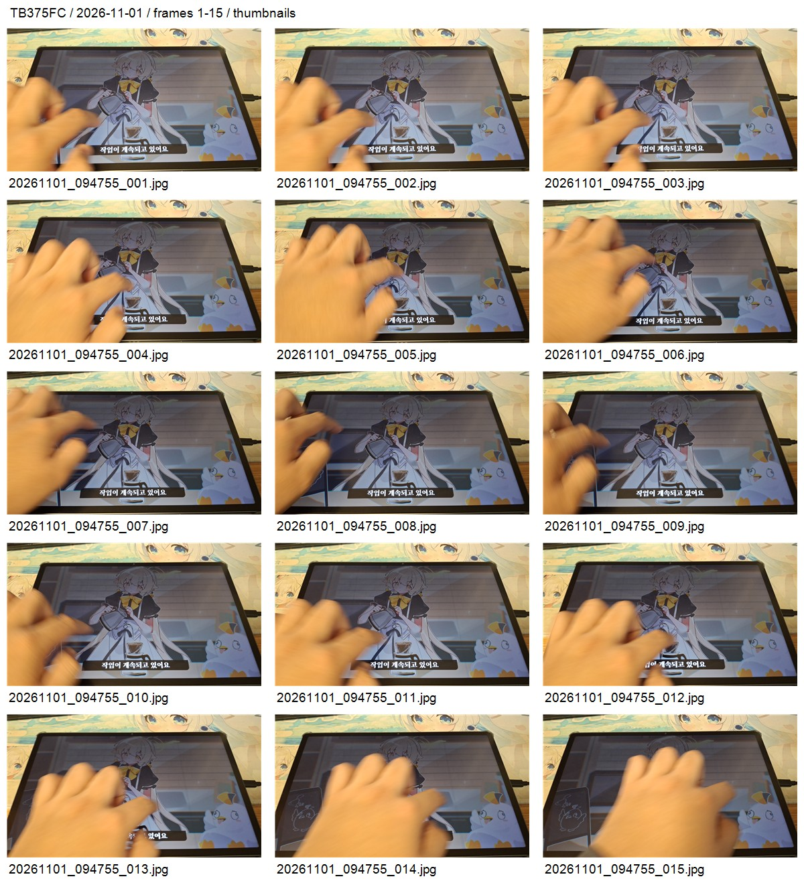
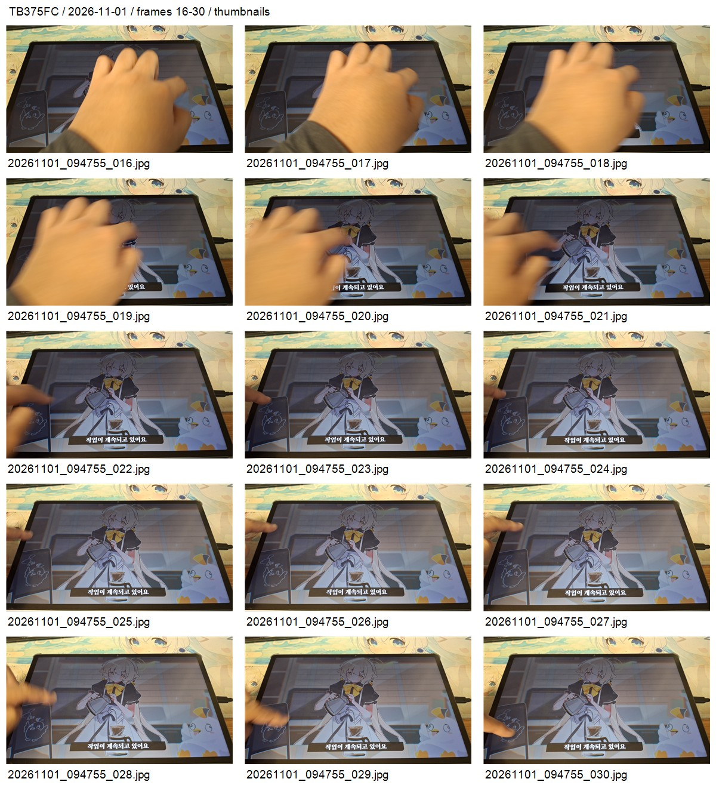

# Historical display-corruption photos — 2026-11-01

> 사용자 승인에 따라 Codex가 사진을 업로드하고 이 안내를 추가했습니다.
> Photos uploaded and this guide added automatically by Codex with the user's authorization.

These **30 original phone photos** document the **A candidate's third display activation** in the same boot on 2026-11-01 KST. They are historical optical evidence, **not photos of the 2026-11-24 FIRST/SECOND comparison** described in the main inquiry.

기존 개발일지 5.7절의 A 후보 추가 시험에서 제공한 연속사진입니다. 별도로 지정된 바탕화면 `_028.jpg`, `_029.jpg`는 이 묶음 안의 동명 원본과 SHA256까지 같아 각각 한 번만 보관합니다.

## Trial context and limits

- Candidate A init_boot SHA256: `4cbe8464689217fae81f5bfd2e6d65ab53a2759130b258738b4b5fb393f5437d`.
- Linux boot ID: `fecfdb5e-12b7-45f0-9f0d-32e2b72be42e`.
- Historical additional-activation result SHA256: `e2dd79fc6ee3cd9721bb83954ef6557039be9ac3c24ff56b0032b57a22842d99`.
- The user reported two vertical bands growing while the picture deteriorated. A moving hand is visible in the sequence. This sequence does not establish a no-touch condition.
- The third activation followed an earlier warm-display failure in that boot; it is not a fresh-boot test.
- All 30 current SHA256 hashes match the historical `user-photo-observation.json` record. See [photo-manifest.json](photo-manifest.json) for original sizes, SHA256 and Git blob hashes.
- Phone capture times and kernel clocks were not exactly synchronized. Sequence numbers are ordering labels; they do not establish exact frame intervals or event timing.
- A camera photo cannot by itself distinguish panel drive faults from all camera/exposure/rolling-shutter effects or establish permanent panel damage or a root cause.
- **Original JPEG bytes and resolution (4080×2296) are preserved.** Contact sheets below are derived, resized/re-encoded navigation thumbnails; use originals for detailed review.

## Contact sheets / 전체 미리보기

Frames 001–015:

Frames 016–030:

## Requested individual photos / 지정하신 개별 사진

### Frame 028 — original

### Frame 029 — original

## All originals / 원본 30장

- [20261101_094755_001.jpg](originals/20261101_094755_001.jpg)
- [20261101_094755_002.jpg](originals/20261101_094755_002.jpg)
- [20261101_094755_003.jpg](originals/20261101_094755_003.jpg)
- [20261101_094755_004.jpg](originals/20261101_094755_004.jpg)
- [20261101_094755_005.jpg](originals/20261101_094755_005.jpg)
- [20261101_094755_006.jpg](originals/20261101_094755_006.jpg)
- [20261101_094755_007.jpg](originals/20261101_094755_007.jpg)
- [20261101_094755_008.jpg](originals/20261101_094755_008.jpg)
- [20261101_094755_009.jpg](originals/20261101_094755_009.jpg)
- [20261101_094755_010.jpg](originals/20261101_094755_010.jpg)
- [20261101_094755_011.jpg](originals/20261101_094755_011.jpg)
- [20261101_094755_012.jpg](originals/20261101_094755_012.jpg)
- [20261101_094755_013.jpg](originals/20261101_094755_013.jpg)
- [20261101_094755_014.jpg](originals/20261101_094755_014.jpg)
- [20261101_094755_015.jpg](originals/20261101_094755_015.jpg)
- [20261101_094755_016.jpg](originals/20261101_094755_016.jpg)
- [20261101_094755_017.jpg](originals/20261101_094755_017.jpg)
- [20261101_094755_018.jpg](originals/20261101_094755_018.jpg)
- [20261101_094755_019.jpg](originals/20261101_094755_019.jpg)
- [20261101_094755_020.jpg](originals/20261101_094755_020.jpg)
- [20261101_094755_021.jpg](originals/20261101_094755_021.jpg)
- [20261101_094755_022.jpg](originals/20261101_094755_022.jpg)
- [20261101_094755_023.jpg](originals/20261101_094755_023.jpg)
- [20261101_094755_024.jpg](originals/20261101_094755_024.jpg)
- [20261101_094755_025.jpg](originals/20261101_094755_025.jpg)
- [20261101_094755_026.jpg](originals/20261101_094755_026.jpg)
- [20261101_094755_027.jpg](originals/20261101_094755_027.jpg)
- [20261101_094755_028.jpg](originals/20261101_094755_028.jpg)
- [20261101_094755_029.jpg](originals/20261101_094755_029.jpg)
- [20261101_094755_030.jpg](originals/20261101_094755_030.jpg)
